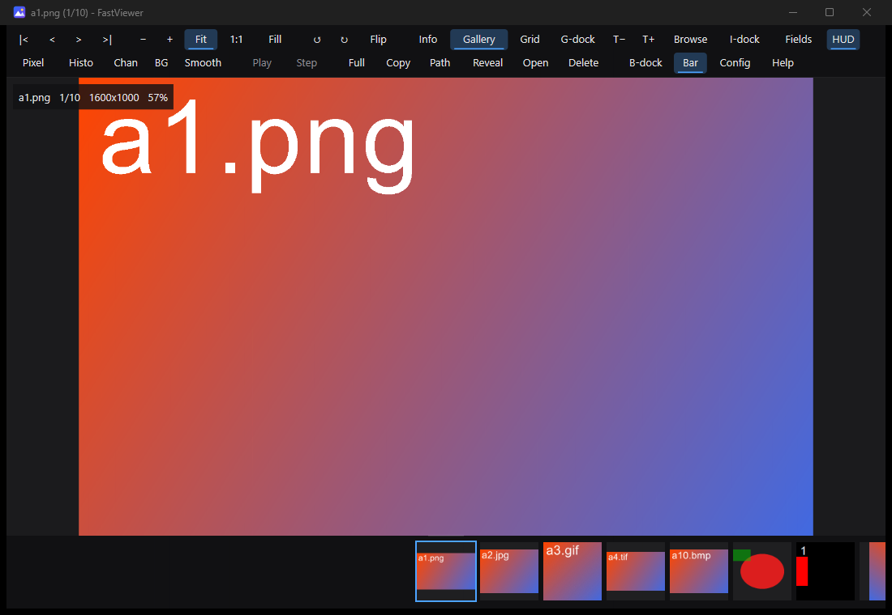

# FastViewer

An ultra-fast, tiny, customizable image viewer for Windows. Double-click to pixels on screen in ~50-60 ms, in a single ~0.75 MB exe with no installer, runtime or DLLs.



## Features
- **Fast**: decoding starts before the window exists; the first frame is drawn with plain GDI while the GPU initializes in the background.
- **Formats**: PNG, JPEG, WebP, GIF, BMP, TIFF, ICO, plus HEIC/AVIF/JXL/DDS where Windows has the codec. Animated **GIF and WebP** play (`A` play/pause, `.` step).
- **Gallery**: thumbnail strip or grid on any edge, browse mode, and **drag thumbnails out into other programs** like files.
- **Inspection**: zoom/pan, pixel inspector and loupe, histogram, channel isolation, measure tool, EXIF/GPS/PNG-text metadata panel.
- **Customizable**: dockable toolbar/gallery/info panels, `fastviewer.ini` for colors, font and every shortcut (`F2` opens it, `F1` shows shortcuts).

## Install
Download `fastviewer.exe` from the [latest release](../../releases/latest) and run it, or register it for "Open with" / Default apps (per-user, no admin):

```powershell
.\install.ps1          # install + register
.\uninstall.ps1        # remove
```

Usage: `fastviewer.exe <file> [more files/folders...]`. Drop any number of files or folders onto the window to build a gallery.

## Build
```powershell
cargo build --release   # target\release\fastviewer.exe
```

See [SPEC.md](SPEC.md) for the full feature list and `tools\` for the self-tests.
